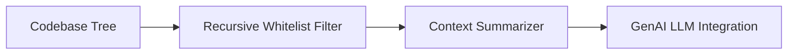

<p align="center">
  
</p>

<p align="center">
   
</p>


## 📌 Table of Contents
- [📖 Executive Summary](#-executive-summary)
- [✨ Key Features & Capabilities](#-key-features--capabilities)
- [🏗️ System Architecture & Workflow](#️-system-architecture--workflow)
- [🛠️ Tech Stack Breakdown](#️-tech-stack-breakdown)
- [⚙️ Reproducible Quickstart & Setup](#️-reproducible-quickstart--setup)
- [📂 Project Directory Layout](#-project-directory-layout)
- [👩‍💻 Author & Contributions](#-author--contributions)

---

## 📖 Executive Summary
### Problem Statement
Analyzing nested software repositories requires recursive file filtering to eliminate binaries, node_modules, and cache files before sending context to LLMs.

### Motivation & Solution Overview
A GenAI exploration containing recursive repository processors and language model interfaces for codebase intelligence.

---

## ✨ Key Features & Capabilities
- **Recursive Tree Filtering:** Eliminates bloat and returns clean source code tokens.
- **LLM Pipeline:** Structured prompt formatting for codebase summarization.

---

## 🏗️ System Architecture & Workflow


---

## 🛠️ Tech Stack Breakdown
| Category | Technologies |
|---|---|
| **Language** | Python |
| **Tools** | GitPython, Streamlit, LLM APIs |

---

## ⚙️ Reproducible Quickstart & Setup
```bash
git clone https://github.com/Bhumikaravi/github-genai.git
cd github-genai
pip install -r "github repo/requirements.txt"
streamlit run "github repo/backend/main.py"
```

---

## 📂 Project Directory Layout
```text
github-genai/
└── github repo/
    ├── backend/
    │   ├── main.py
    │   └── services/
    │       ├── llm_service.py
    │       └── repo_processor.py
    └── requirements.txt
```

---

## 👩‍💻 Author & Contributions
Developed by **Bhumika Ravi** ([@Bhumikaravi](https://github.com/Bhumikaravi)), Bachelor of Computer Applications (BCA) at **Alliance University, Bengaluru**.

- 💻 **GitHub Profile:** [github.com/Bhumikaravi](https://github.com/Bhumikaravi)
- 🔗 **LinkedIn:** [linkedin.com/in/bhumika-ravi-b5a01b326](https://www.linkedin.com/in/bhumika-ravi-b5a01b326/)
- 📬 **Email Contact:** [bhumikaravi2006@gmail.com](mailto:bhumikaravi2006@gmail.com)

---

<p align="center">
  
</p>
